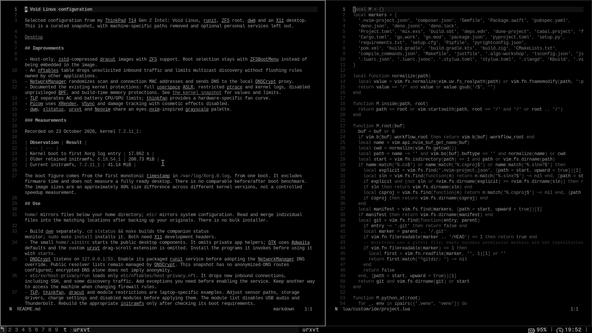

# Void Linux configuration

Selected configuration from my ThinkPad T14 Gen 2 Intel: Void Linux, runit, ZFS root, dwm and an X11 desktop. This is a curated snapshot, with machine-specific paths removed and optional personal services left out.

## Improvements

- Host-only, zstd-compressed dracut images with ZFS support. Root selection stays with ZFSBootMenu instead of being embedded in the image.
- An nftables table drops unsolicited inbound traffic and limits multicast discovery without flushing rules owned by other applications.
- NetworkManager randomizes scan and connection MAC addresses and sends DNS to the local DNSCrypt proxy.
- Documented the existing kernel protections: full userspace ASLR, restricted ptrace and kernel logs, disabled unprivileged BPF, and build-time memory protections. See [the kernel snapshot](KERNEL.md) for values and limits.
- TLP separates AC and battery CPU/GPU limits; thinkfan provides a hardware-specific fan curve.
- Picom uses XRender, VSync and damage tracking with cosmetic effects disabled.
- dwm, slstatus, urxvt and Neovim share an eyes.nvim-inspired grayscale palette.

### Measurements

Recorded on 23 October 2026, kernel `7.2.11_1`:

| Observation | Result |
| --- | --- |
| Kernel boot to first Xorg log entry | 17.862 s |
| Older retained initramfs, `6.18.54_1` | 208.73 MiB |
| Current initramfs, `7.2.11_1` | 41.14 MiB |

The boot figure comes from the first monotonic timestamp in `/var/log/Xorg.0.log`, from one boot. It excludes firmware time and does not measure a fully ready desktop. There is no comparable before/after boot benchmark. The image sizes are an approximately 80% size difference across different kernel versions, not a controlled speedup measurement.

## Use

`home/` mirrors files below your home directory; `etc/` mirrors system configuration. Read and merge individual files into the matching locations after backing up your originals. There is no bulk installer.

- Build [dwm](https://github.com/merthium/dwm) separately. `cd slstatus && make` builds the companion status monitor; `sudo make install` installs it. Both need X11 development headers.
- The small `home/.xinitrc` starts the public desktop components. It omits private app helpers; GTK uses Adwaita defaults and the custom urxvt drag-scroll extension is omitted. Install the programs it invokes before using it with `startx`.
- `etc/dnscrypt-proxy/dnscrypt-proxy-settings.toml` is a settings excerpt: merge its top-level values into your packaged `dnscrypt-proxy.toml`, before any table headers. Keep the packaged `[sources]` tables and their public signature-verification keys. Do not replace the full configuration with this excerpt. DNSCrypt listens on `127.0.0.1:53`. Enable its packaged runit service before adopting the NetworkManager DNS override. Public resolver lists remain managed by DNSCrypt. This snapshot has no anonymized-DNS routes configured; encrypted DNS alone does not imply anonymity.
- `etc/sv/host-privacy/run` loads only `etc/nftables/host-privacy.nft`. It drops new inbound connections, including SSH, and some discovery traffic. Add exceptions you need before enabling the service. Keep another way to access the machine when changing firewall rules.
- TLP, thinkfan, dracut and module restrictions are laptop-specific examples. Adjust sensor paths, storage drivers, charge settings and disabled modules before applying them. The module list disables USB audio and Thunderbolt. Rebuild the appropriate initramfs only after checking its boot requirements.

No SSH/WireGuard keys, network profiles, browser data, credentials, host IDs or full machine logs are included. Kernel command-line hardening and Anonymized DNS are not claimed because the inspected running setup did not establish them.

## Credits

Inspired by the small, composable tools documented in the [Void Handbook](https://docs.voidlinux.org/) and [suckless](https://suckless.org/). Palette: [eyes.nvim](https://github.com/amedoeyes/eyes.nvim). slstatus is based on [suckless slstatus](https://tools.suckless.org/slstatus/), with its upstream license preserved in `slstatus/LICENSE`.

Related: [dwm](https://github.com/merthium/dwm) · [Neovim](https://github.com/merthium/nvim).
